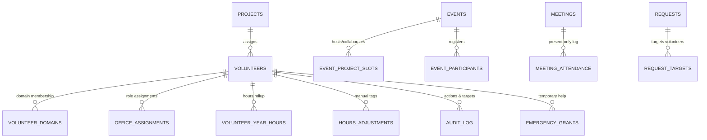

# NSS Central Management System — Database Architecture & Schema Specification

> Conforms strictly to **docs/SRS.md Section 8** and the institutional requirements.

---

## 1. Storage Philosophy & Principles

1. **Universal Volunteer Hierarchy (Rule 1)**: Every user who logs in (Coordinators, Tech Team, Builders, Project Representatives) is a volunteer with a row in `volunteers`. Roles rotate annually in `office_assignments`.
2. **Identifier Conventions (Rule 10)**:
   - `roll_number`: Canonical string PK for students, validated against `ROLL_NUMBER_PATTERN` in `src/config/identity.ts` (`/^[0-9]{6,10}$/`).
   - `events`, `meetings`, `office_assignments`, `requests`, `hours_adjustments`, `emergency_grants`: Integer identity PKs (`id integer generated always as identity primary key`).
   - `projects`: Fixed smallint IDs 1 to 9 (Appendix A.1).
3. **Derived / Non-Stored Values (Rule 8)**: Rates (`attendance_rate_events`, `attendance_rate_meetings`), `academic_year` / `year`, email (`<roll_number>@kiit.ac.in`), project active status, and `ONGOING` event status are **computed in code**, never stored as redundant database columns.
4. **Attendance Efficiency**:
   - `events`: Registered FCFS / walk-ins tracked in `event_participants` (`PRESENT`, `ABSENT`, `EXCUSED`).
   - `meetings`: **Present-only** rows in `meeting_attendance` (`meeting_id`, `roll_number`). Absences are derived against eligible rolls.
5. **Timezone Standardization**: All timestamps stored in `timestamptz` normalized to UTC in PostgreSQL; always displayed in `Asia/Kolkata` (IST) in application layers.
6. **Retention Horizon**: Daily cleanup jobs retain 3.5 years (42 months) of event records and 30 days default audit logs.

---

## 2. Entity Relational Design



---

## 3. PostgreSQL Schema (DDL)

```sql
-- Enums
create type user_role as enum ('COORDINATOR', 'TECH_TEAM', 'BUILDER', 'PROJECT_REPRESENTATIVE');
create type tech_kind as enum ('MEMBER', 'MENTOR');
create type builder_kind as enum ('GENERAL', 'POC', 'DOMAIN_LEAD');
create type access_status as enum ('ACTIVE', 'SUSPENDED', 'REVOKED');
create type volunteer_status as enum ('ACTIVE', 'SUSPENDED', 'ARCHIVED');
create type gender as enum ('MALE', 'FEMALE', 'OTHER');
create type creative_domain as enum ('PHOTOGRAPHY', 'VIDEO_EDITING', 'GRAPHIC_DESIGNING', 'CONTENT_WRITING');
create type event_type as enum ('CENTRAL', 'PROJECT');
create type participation_mode as enum ('FCFS', 'OPEN_TO_ALL');
create type stored_event_status as enum ('DRAFT', 'SCHEDULED', 'PUBLISHED', 'RESCHEDULED', 'COMPLETED', 'CANCELLED', 'ARCHIVED');
create type attendance_status as enum ('PRESENT', 'ABSENT', 'EXCUSED');
create type participant_source as enum ('FCFS', 'WALK_IN', 'AUTO');
create type collab_approval as enum ('PENDING', 'APPROVED', 'REJECTED');
create type meeting_type as enum ('PROJECT', 'CENTRAL', 'BUILDERS');
create type meeting_status as enum ('SCHEDULED', 'COMPLETED', 'CANCELLED', 'RESCHEDULED');
create type request_kind as enum ('SUSPEND_VOLUNTEER', 'ARCHIVE_VOLUNTEER', 'DELETE_VOLUNTEER');
create type request_status as enum ('PENDING', 'APPROVED', 'REJECTED', 'CANCELLED', 'EXPIRED');
create type emergency_pack as enum ('PROJECT_VIEW_BASIC', 'PROJECT_EDIT_BASIC', 'EVENT_FCFS', 'EVENT_ATTENDANCE', 'MEETING_RUN');
create type audit_action as enum (
  'VOLUNTEER_CREATE', 'VOLUNTEER_UPDATE', 'VOLUNTEER_STATUS_CHANGE', 'VOLUNTEER_SUSPEND', 'VOLUNTEER_REINSTATE',
  'VOLUNTEER_ARCHIVE', 'VOLUNTEER_DELETE', 'PROJECT_AFFILIATION_CHANGE', 'DOMAIN_MEMBERSHIP_CHANGE', 'VOLUNTEER_NOTE_UPDATE',
  'RED_FLAG_ADD', 'RED_FLAG_REVOKE', 'REQUEST_CREATE', 'REQUEST_APPROVE', 'REQUEST_REJECT', 'REQUEST_CANCEL',
  'ROLE_GRANT', 'ROLE_REVOKE', 'STAFF_SUSPEND', 'LOGIN_DENIED', 'EMERGENCY_ACCESS_GRANT', 'EMERGENCY_ACCESS_REVOKE',
  'EVENT_CREATE', 'EVENT_UPDATE', 'EVENT_PUBLISH', 'EVENT_RESCHEDULE', 'EVENT_CANCEL', 'EVENT_COLLAB_APPROVE',
  'EVENT_COLLAB_REJECT', 'EVENT_COLLAB_FORCE', 'EVENT_LOCK', 'EVENT_UNLOCK', 'EVENT_FINALIZE', 'EVENT_ARCHIVE',
  'FCFS_ENTRY', 'FCFS_EDIT', 'FCFS_REMOVE', 'EDIT_BUDGET_GRANT', 'EVENT_GROUP_CHANGE', 'EVENT_CATEGORY_CHANGE',
  'ATTENDANCE_MARK', 'ATTENDANCE_CORRECT', 'MEETING_CREATE', 'MEETING_UPDATE', 'MEETING_START', 'MEETING_END',
  'MEETING_CANCEL', 'MEETING_RESCHEDULE', 'MEETING_MOM', 'MEETING_ATTENDANCE_MARK', 'MEETING_LOCK', 'MEETING_UNLOCK',
  'MEETING_FINALIZE', 'HOURS_APPROVE', 'HOURS_ADJUST', 'HOURS_RECOMPUTE', 'HOURS_TYPE_CHANGE', 'CSV_EXPORT',
  'FEATURE_FLAG_CHANGE', 'SETTINGS_CHANGE', 'RETENTION_RUN', 'COUNTERS_REBUILD', 'CRON_RUN', 'RATE_LIMIT_TRIP', 'IMPORT_UNDO'
);
create type audit_entity_type as enum (
  'VOLUNTEER', 'PROJECT', 'EVENT', 'MEETING', 'ATTENDANCE', 'FCFS', 'HOURS', 'ROSTER', 'STAFF', 'REQUEST', 'EXPORT', 'SYSTEM'
);
create type audit_outcome as enum ('SUCCESS', 'FAILURE', 'DENIED');

-- 1. Projects
create table projects (
  id               smallint primary key check (id between 1 and 9),
  name             text not null unique,
  slug             text not null unique,
  sdgs             smallint[] not null check (cardinality(sdgs) between 1 and 4),
  tagline          text not null default '',
  description      text not null default '',
  accent_color     text not null default 'blue',
  last_activity_at timestamptz,
  updated_at       timestamptz not null default now()
);

-- 2. Volunteers
create table volunteers (
  roll_number           text primary key check (roll_number ~ '^[A-Za-z0-9_-]{4,20}$'),
  name                  text not null check (char_length(name) between 2 and 80),
  phone                 text check (phone is null or phone ~ '^\+?[0-9 ]{7,16}$'),
  gender                gender not null,
  status                volunteer_status not null default 'ACTIVE',
  project_id            smallint not null references projects(id),
  batch_year            smallint not null check (batch_year between 2000 and 2100),
  blood_group           text check (blood_group in ('A+','A-','B+','B-','AB+','AB-','O+','O-')),
  city_state            text,
  hostel                text,
  events_attended       integer not null default 0,
  events_fcfs_final     integer not null default 0,
  events_fcfs_present   integer not null default 0,
  events_missed_fcfs    integer not null default 0,
  meetings_present      integer not null default 0,
  meetings_absent       integer not null default 0,
  red_flags             integer not null default 0,
  join_date             timestamptz not null default now(),
  notes                 text check (notes is null or char_length(notes) <= 500),
  notes_updated_by      text references volunteers(roll_number),
  notes_updated_at      timestamptz,
  created_at            timestamptz not null default now(),
  updated_at            timestamptz not null default now()
);

create index vol_project_status_idx on volunteers (project_id, status);
create index vol_batch_idx on volunteers (batch_year);

-- 3. Creative Domains
create table volunteer_domains (
  roll_number text not null references volunteers(roll_number) on delete cascade,
  domain      creative_domain not null,
  primary key (roll_number, domain)
);

-- 4. Office Assignments (Roster & Role History)
create table office_assignments (
  id            integer generated always as identity primary key,
  roll_number   text not null references volunteers(roll_number),
  role          user_role not null,
  tech_kind     tech_kind,
  builder_kind  builder_kind,
  project_id    smallint references projects(id),
  pr_slot       smallint check (pr_slot in (1, 2)),
  domain        creative_domain,
  status        access_status not null default 'ACTIVE',
  starts_at     timestamptz not null default now(),
  ends_at       timestamptz,
  granted_by    text not null references volunteers(roll_number),
  ended_by      text references volunteers(roll_number),
  end_reason    text check (end_reason is null or char_length(end_reason) between 5 and 300),
  check (ends_at is null or ends_at > starts_at)
);

create index office_active_roll_idx on office_assignments (roll_number) where ends_at is null and status = 'ACTIVE';

-- 5. Events & Lifecycles
create table event_categories (
  id            smallint generated always as identity primary key,
  name          text not null unique check (char_length(name) between 3 and 60),
  default_hours numeric(4,1) not null check (default_hours between 0.5 and 50)
);

create table event_groups (
  id            integer generated always as identity primary key,
  title         text not null check (char_length(title) between 3 and 100),
  max_hours     numeric(4,1) not null check (max_hours between 1 and 200),
  academic_year smallint not null
);

create table events (
  id                  integer generated always as identity primary key,
  title               text not null check (char_length(title) between 3 and 120),
  description         text not null check (char_length(description) between 10 and 2000),
  type                event_type not null,
  participation       participation_mode not null default 'FCFS',
  status              stored_event_status not null default 'DRAFT',
  venue               text not null check (char_length(venue) between 2 and 120),
  starts_at           timestamptz not null,
  ends_at             timestamptz,
  fcfs_opens_at       timestamptz,
  fcfs_lock_at        timestamptz,
  attendance_locked   boolean not null default false,
  attendance_lock_at  timestamptz not null,
  finalized_at        timestamptz,
  category_id         smallint references event_categories(id),
  group_id            integer references event_groups(id) on delete set null,
  counts_for_group    boolean not null default false,
  hours               numeric(4,1) check (hours is null or hours between 0.5 and 50),
  hours_approved_at   timestamptz,
  hours_approved_by   text references volunteers(roll_number),
  academic_year       smallint not null,
  created_by          text references volunteers(roll_number),
  created_by_role     user_role,
  reschedule_count    smallint not null default 0,
  edits_left          smallint not null default 2,
  cancellation_reason text,
  snapshot_eligible   integer,
  snapshot_present    integer,
  snapshot_female     integer,
  snapshot_male       integer,
  snapshot_other      integer,
  is_imported         boolean not null default false,
  created_at          timestamptz not null default now(),
  updated_at          timestamptz not null default now()
);

create table event_project_slots (
  event_id     integer not null references events(id) on delete cascade,
  project_id   smallint not null references projects(id),
  is_host      boolean not null default false,
  approval     collab_approval not null default 'PENDING',
  approved_by  text references volunteers(roll_number),
  approved_at  timestamptz,
  slots_total  smallint check (slots_total is null or slots_total between 1 and 500),
  cap_year2    smallint,
  cap_year3    smallint,
  cap_year4    smallint,
  edits_left   smallint not null default 2,
  primary key (event_id, project_id)
);

create table event_participants (
  event_id     integer not null references events(id) on delete cascade,
  roll_number  text not null references volunteers(roll_number),
  source       participant_source not null default 'FCFS',
  status       attendance_status not null default 'ABSENT',
  added_by     text not null references volunteers(roll_number),
  added_at     timestamptz not null default now(),
  marked_by    text references volunteers(roll_number),
  marked_at    timestamptz,
  primary key (event_id, roll_number)
);

-- 6. Meetings
create table meetings (
  id                  integer generated always as identity primary key,
  type                meeting_type not null,
  project_id          smallint references projects(id),
  agenda              text not null check (char_length(agenda) between 5 and 300),
  date                date not null,
  start_time          time not null,
  end_time            time,
  venue               text not null check (char_length(venue) between 2 and 120),
  status              meeting_status not null default 'SCHEDULED',
  started_at          timestamptz,
  ended_at            timestamptz,
  mom                 text check (mom is null or char_length(mom) between 5 and 1000),
  mom_by              text references volunteers(roll_number),
  mom_edits_left      smallint not null default 2,
  edits_left          smallint not null default 2,
  attendance_locked   boolean not null default false,
  attendance_lock_at  timestamptz not null,
  finalized_at        timestamptz,
  snapshot_eligible   integer,
  snapshot_present    integer,
  snapshot_female     integer,
  snapshot_male       integer,
  snapshot_other      integer,
  cancellation_reason text,
  created_by          text not null references volunteers(roll_number),
  created_by_role     user_role not null,
  created_at          timestamptz not null default now(),
  updated_at          timestamptz not null default now()
);

-- Present-only attendance rows for meetings
create table meeting_attendance (
  meeting_id  integer not null references meetings(id) on delete cascade,
  roll_number text not null references volunteers(roll_number),
  marked_by   text not null references volunteers(roll_number),
  marked_at   timestamptz not null default now(),
  primary key (meeting_id, roll_number)
);

-- 7. Hours Accounting
create table hours_adjustment_types (
  id            smallint generated always as identity primary key,
  name          text not null unique check (char_length(name) between 3 and 60),
  default_hours numeric(4,1) not null check (default_hours between 0.5 and 50),
  is_active     boolean not null default true
);

create table hours_adjustments (
  id             integer generated always as identity primary key,
  roll_number    text not null references volunteers(roll_number),
  academic_year  smallint not null,
  type_id        smallint not null references hours_adjustment_types(id),
  hours          numeric(4,1) not null check (hours between -50 and 50 and hours <> 0),
  reason         text not null check (char_length(reason) between 5 and 300),
  assigned_by    text not null references volunteers(roll_number),
  assigned_at    timestamptz not null default now()
);

create table volunteer_year_hours (
  roll_number             text not null references volunteers(roll_number),
  academic_year           smallint not null,
  hours_from_events       numeric(5,1) not null default 0,
  hours_from_adjustments  numeric(5,1) not null default 0,
  hours_from_legacy       numeric(5,1) not null default 0,
  total                   numeric(5,1) not null default 0,
  updated_at              timestamptz not null default now(),
  primary key (roll_number, academic_year)
);

-- 8. Governance Requests (Two-Man Rule)
create table requests (
  id              integer generated always as identity primary key,
  kind            request_kind not null,
  status          request_status not null default 'PENDING',
  reason          text not null check (char_length(reason) between 10 and 500),
  created_by      text not null references volunteers(roll_number),
  created_at      timestamptz not null default now(),
  decided_by      text references volunteers(roll_number),
  decided_at      timestamptz,
  decision_reason text check (decision_reason is null or char_length(decision_reason) between 5 and 300),
  expires_at      timestamptz not null default (now() + interval '14 days')
);

create table request_targets (
  request_id   integer not null references requests(id) on delete cascade,
  roll_number  text not null references volunteers(roll_number),
  primary key (request_id, roll_number)
);

-- 9. Immutable Audit Log
create table audit_log (
  id             bigint generated always as identity primary key,
  at             timestamptz not null default now(),
  actor_roll     text references volunteers(roll_number),
  actor_role     user_role,
  action         audit_action not null,
  entity_type    audit_entity_type not null,
  entity_id      text not null,
  target_roll    text references volunteers(roll_number),
  project_id     smallint references projects(id),
  outcome        audit_outcome not null,
  correlation_id uuid not null,
  reason         text,
  summary        text not null check (char_length(summary) <= 200),
  changes        jsonb,
  client_ip      inet
);

create index audit_at_idx on audit_log (at desc);
create index audit_actor_idx on audit_log (actor_roll, at desc);

-- 10. Emergency Grants
create table emergency_grants (
  id           integer generated always as identity primary key,
  roll_number  text not null references volunteers(roll_number),
  pack         emergency_pack not null,
  project_id   smallint references projects(id),
  event_id     integer references events(id) on delete cascade,
  meeting_id   integer references meetings(id) on delete cascade,
  reason       text not null check (char_length(reason) between 10 and 300),
  granted_by   text not null references volunteers(roll_number),
  starts_at    timestamptz not null default now(),
  expires_at   timestamptz not null,
  revoked_at   timestamptz,
  revoked_by   text references volunteers(roll_number),
  check (expires_at > starts_at and roll_number <> granted_by)
);

-- 11. Settings & Unlogged Helpers
create table settings (
  key        text primary key,
  value      jsonb not null,
  updated_by text references volunteers(roll_number),
  updated_at timestamptz not null default now()
);

create unlogged table rate_limits (
  bucket       text not null,
  window_start timestamptz not null,
  hits         integer not null default 1,
  primary key (bucket, window_start)
);

create unlogged table idempotency_keys (
  key        uuid primary key,
  actor_roll text not null,
  created_at timestamptz not null default now()
);
```
